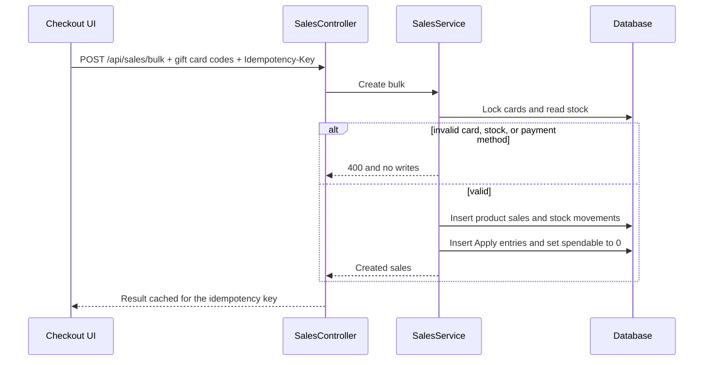
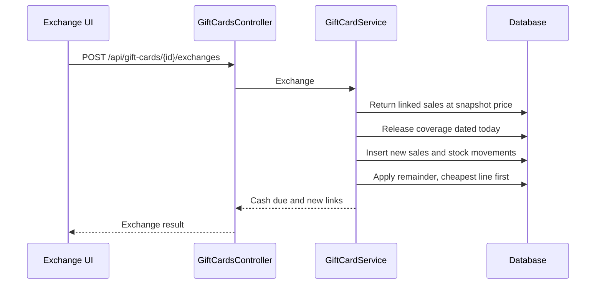

# Design

## Context

Sales are one `Sale` per product line, grouped by `BulkOperationId`. `Sale.Price` is an 18,2 snapshot and `GetTotal()` is `Price × Quantity`. Dashboard and reports sum that gross, then subtract returns (`ReturnSale.Quantity × UnitPrice`). A sale with any return drops out of today, week, trend, and payment-mix queries (`!ReturnSales.Any()`). Commission walks `SaleReportLine.Amount` in `SaleDate` order and subtracts returns on `ReturnDate`. Bulk checkout (`CreateBulkSalesRequest`) is one POS, one payment method, and an in-memory `IdempotencyStore`. There is no customer entity and no gift card. See proposal.md for why.

## Goals / Non-Goals

**Goals:**

- Record issuance, coverage, and exchanges so period revenue equals cash collected, without rewriting an earlier `Sale.Price`.
- Move jewelry stock only through the existing sale and return movements.
- Keep one shared query for the economic amount used by reports, dashboard, and commission.

**Non-Goals:**

- Changing the rule that drops a returned sale from the payment mix.
- A second payment method on a single checkout.

## Decisions

### 1. Coverage is a dated ledger, not a change to the card sale

`GiftCard` holds `NominalAmount` (immutable) and `SpendableBalance`. `Sale.Price` on the issuance sale stays at the nominal for the life of the card.

`GiftCardCoverageEntry` is append-only:

- `Apply`: positive amount, dated the redemption or exchange, linked to the product `SaleId` and the card.
- `Release`: positive amount, dated the exchange, linked to the sale whose coverage is being given back.

Period revenue is `sum(Sale.Price × Quantity) − sum(returns) − sum(Apply) + sum(Release)` for entries whose date falls in the period. The issuance row is never updated, so 1 March stays 100 EUR when a 150 EUR product is sold on 15 March with a 100 EUR apply. That day nets 50 EUR.

Accounted remainder is `NominalAmount − (sum Apply − sum Release)` for that card. Spendable balance is set to 0 when the card first gets an apply, including when apply is less than nominal. Spendable balance never increases after the issuance sale is linked. Releases and downgrades only change accounted remainder, not spendable balance.

Issuance expiry is stored as a UTC calendar date strictly after the issuance UTC date. Redemption is allowed through `23:59:59.999` UTC on that expiry date. The classic return flow rejects both jewelry sales with coverage and the issuance sale linked to `GiftCard`.

Alternative: lower `Sale.Price` on the card when it is redeemed. That rewrites the issuance day and cannot put the 100 EUR reduction on 15 March. Rejected.

Alternative: two product sales, one dated on issuance for the covered part. The user chose a single product sale on the redemption date. Rejected.

### 2. Exchange releases coverage instead of deleting it

A classic return stores `UnitPrice = Sale.Price` and subtracts the full catalog amount. If the original apply stayed in every future total, the covered part would be removed twice (once by the return, once by the apply). Deleting the apply would rewrite the redemption day.

On exchange day the transaction writes, in order:

1. Return of the linked sales at full snapshot price, stock in, return category required.
2. `Release` entries for the coverage that belonged to the returned quantity, dated today.
3. New product sales at catalog price, stock out, same POS, one payment method.
4. `Apply` entries for the coverage consumed by the new sales, cheapest line first, capped by the accounted remainder after the release.
5. Cash charged = new total − returned total − newly applied amount, and never below 0. When that difference is negative, the extra release stays in the accounted remainder and spendable balance stays 0.

Returned product links stay on the card via the original apply plus the release. New products get their own apply rows.

### 3. System product and `GIFT_CARD` payment method

Add nullable `Product.SystemProductKind` (`GiftCard` only for now). Seed one product, SKU `SYS-GIFT-CARD`, price 0.01 so `Product.IsPriceValid()` holds. Issuance writes `Sale.Price` = face value, `PriceWasOverridden = false`, and skips the manual-price-edit check and the inventory movement. Catalog, search, import, and recognition filter `SystemProductKind == null`. `POST /api/sales/bulk` rejects any line whose product has a non-null `SystemProductKind`.

Seed payment method code `GIFT_CARD`, Spanish name "Tarjeta regalo", assigned active on every POS, omitted from the sales payment dropdown, and rejected by deactivation. Fully covered checkouts set `CreateBulkSalesRequest.PaymentMethodId` to that method. Partial checkouts keep the operator's remainder method on every line.

### 4. Checkout and exchange stay on the existing sale and return pipelines

`CreateBulkSalesRequest` gains `List<string> GiftCardCodes`. `SalesService` bulk checkout, inside the current transaction:

- locks the selected cards (`UPDLOCK`)
- rejects expired, wrong POS, already used (`SpendableBalance == 0`), or unknown codes
- allocates cheapest line first, then card order
- writes sales, movements, apply entries, and spendable updates
- rolls all of that back on any failure

The existing `Idempotency-Key` on `POST /api/sales/bulk` covers this body. Issuance is `POST /api/gift-cards` with its own idempotency key so a retry does not create a second card. Exchange is `POST /api/gift-cards/{id}/exchanges`, also idempotent, and it calls the return and sale services in one transaction rather than a new stock path.

`SaleDto` and sales history gain `GiftCardCoverageAmount` (net apply minus release on that sale) so dashboard charts, which aggregate `GET /api/sales` in the browser, can subtract coverage without a second endpoint.

### 5. One economic amount for commission

`SaleReportLine.Amount` and return events for commission use the economic amount, not a second formula. Jewelry with no coverage is unchanged (`Price × Quantity`, returns at `UnitPrice`). Issuance uses nominal. A covered product sale uses gross minus apply entries on that sale dated the sale. An exchange adds a return event for the full snapshot and a release event that adds the released coverage back, then the new sale uses its own economic amount. The three-step 21% VAT formula is unchanged and runs on that amount. `GetSaleLinesForCommissionReportAsync` is the place that subtracts coverage so dashboard and sales report cannot drift.

### 6. Codes, print, and scan

Codes are `GC-` plus 8 Crockford base32 characters, unique index. The card screen reuses `frontend/src/lib/code128.ts` and `QrCodeService` (encode the code, not a product SKU). The sales scanner, on a value that starts with `GC-`, calls `GET /api/gift-cards/by-code/{code}` scoped to the checkout POS. The API returns 404 for unknown codes and 400 for expired, wrong-POS, or already-used cards; the UI shows the error immediately and does not search products. Browser print uses the existing SVG download plus `window.print` on that panel. No new scanner library.

Exchange accepts multiple linked sale lines and multiple replacement products in one idempotent request, applying the same return → release → sale → apply sequence as the single-line case.

### 7. Reassignment

`GiftCard.PointOfSaleId` is the current POS. `GiftCardReassignment` stores `GiftCardId`, `FromPointOfSaleId`, `ToPointOfSaleId`, `UserId`, `OccurredAt`. The issuance `Sale.PointOfSaleId` is not updated. Admin only.

## Sequence

## Risks / Trade-offs

- [Payment mix drops the whole sale after an exchange] → Accepted. The new sale contributes only its cash portion; the issuance sale stays on the original method. Totals still match cash collected, but the method that received the original top-up disappears from the chart.
- [Charts aggregate sales in the browser] → `GiftCardCoverageAmount` on each sale. Missing it would show the catalog price in the trend. Tasks cover the DTO and the chart math.
- [Coverage ledger can get out of step with spendable balance] → Both are written in the same transaction. Tests assert the five purchase examples and the three exchange deltas.
- [In-memory idempotency is lost on process restart] → Same limitation as bulk checkout today. A unique constraint on `(IdempotencyKey)` is not added in this change.
- [`GIFT_CARD` hidden in the dropdown but required when the cart is fully covered] → The client sends it only in that case. The API rejects a jewelry-only checkout that uses `GIFT_CARD` without a card that covers every line.

## Migration Plan

1. Add tables and `Product.SystemProductKind`. Seed `SYS-GIFT-CARD` and `GIFT_CARD`, and assign `GIFT_CARD` to existing POS rows.
2. Deploy API before the UI. Old clients omit `GiftCardCodes`; bulk checkout behaves as today.
3. Rollback: the new tables and the nullable column can be dropped. No existing sale row is rewritten, so jewelry history stays valid.

## Open Questions

None. Deferred choices would change the specs or the ledger above.
