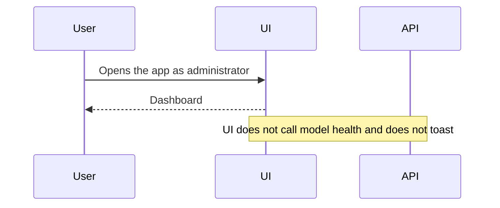
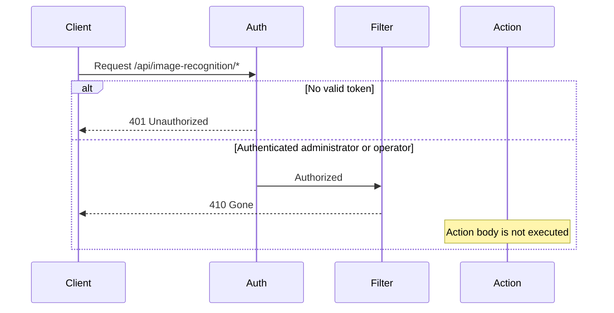
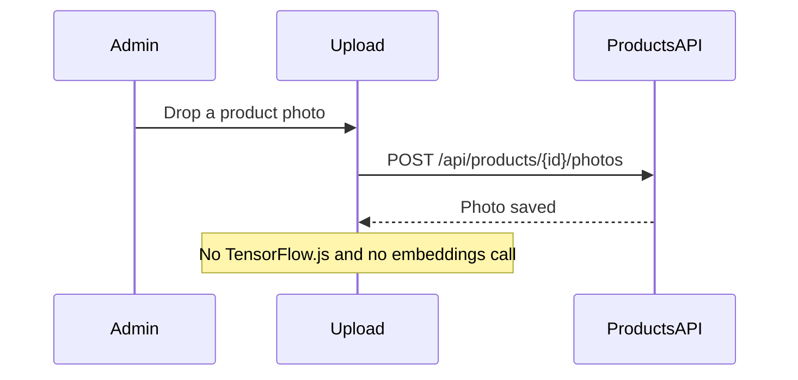

## Context

Product-photo recognition is implemented end to end and unused. The admin UI still requests `GET /api/image-recognition/model/health` after login and shows a warning toast when the alert level is high. Operators can still open `/sales/new/image`. Administrators can still open `/admin/ai-model` from the sidebar entry "Modelo de IA". Product photo upload still loads MobileNetV2 and posts embeddings.

The backend keeps `ImageRecognitionController` at `api/image-recognition`, `ImageRecognitionService`, `ModelHealthService`, and their DI registration in `ServiceCollectionExtensions`. Several actions are `[Authorize(Roles = "Administrator")]`; the controller class is `[Authorize]`. Integration tests currently expect successful embedding and health responses, including 403 for operators on admin-only embedding writes.

Product photos, sales, stock, and payments are separate flows. `ProductPhoto`, `ProductPhotoEmbedding`, `SalePhoto`, and `ModelMetadata` stay in the schema described in `Documentos/modelo-de-datos.md`. No migration in this change.

Layout 38's GPT/Claude/Gemini selector is a Metronic demo. It is not the product recognition model.

## Goals / Non-Goals

**Goals:**

- Stop every user-visible warning and screen for product-photo recognition.
- Leave the backend types, method bodies, tests of those services, and database rows in place.
- Make the HTTP API report withdrawal with 410 for any authenticated caller.
- Keep catalog photo upload working without embeddings or recognition copy.
- Bring current product docs and active specs in line with that behavior.
- Mark archived OpenSpec changes and master notes that describe this feature as historical, without rewriting them.

**Non-Goals:**

- Deleting backend recognition source, migrations, tables, or stored model files.
- Adding a not-found page. Unmatched paths already redirect to `/dashboard`.
- Changing manual sales, cart checkout, stock, payments, returns, or gift cards.
- Removing the layout-38 demo.
- Rewriting historical document bodies.

## Decisions

### 1. Short-circuit the controller; keep the method bodies

An action filter on `ImageRecognitionController` sets 410 Gone and does not call the action. Method bodies stay compiled and unexecuted. The response body states, in Spanish, that product-photo image recognition is withdrawn, with a stable code `image_recognition_withdrawn`.

Alternatives:

- Delete or comment out the action bodies. Rejected: the backend source must remain.
- Leave the actions live and only add `[Obsolete]`. Rejected: callers would still receive model health and the admin warning could return.
- Return 410 from middleware for the whole path, including anonymous callers. Rejected: unauthenticated calls stay 401.

### 2. Any authenticated caller receives 410

Role attributes on this controller are removed so an operator is not answered 403 before the filter runs. Class-level `[Authorize]` stays, so a missing token is still 401. The filter then returns 410 for both Administrator and Operator.

Alternative: keep admin role checks and return 403 to operators. Rejected: the capability is withdrawn for every role, and 403 still looks like a permission problem.

### 3. Deprecation markers

`[Obsolete]` with the message "Product-photo image recognition is withdrawn. Endpoints return 410 Gone." goes on the controller and on `IImageRecognitionService` and `IModelHealthService`. XML remarks on those types say the same. DI registration stays. The project does not treat warnings as errors, so the obsolete references inside the deprecated controller remain a visible warning rather than a broken build. Do not add new callers outside that controller.

### 4. Frontend removal, catalog photos stay

Delete the health toast, AI-model page, image sales page, recognition and training services, their tests, TensorFlow.js, and the test setup that exists only for it. Remove the routes and the "Modelo de IA" menu item. Do not add a not-found page or a dedicated redirect. `app-routing-setup.tsx` already sends unmatched paths to `/dashboard`.

In product photo upload, remove feature extraction, embedding posts, and recognition wording. Keep drag-and-drop, JPG/PNG validation, primary photo, and delete through the product photo API.

`sales.service` keeps sales methods. Only the image-recognition client in that module is removed.

### 5. Documentation split

Current product documents are edited so they no longer present recognition as available: `README.md`, `Documentos/epicas.md`, affected historias, `Documentos/Guias/ventas-registro.md`, `Documentos/Guias/admin-modelo-ia.md`, `arquitectura.md`, `modelo-c4.md`, and `modelo-de-datos.md`. Entity sections stay, with a note that the app no longer reads or writes them for recognition.

Archived OpenSpec changes for this feature, and master or proposal notes that describe it as current behavior, get this banner as the first line and keep the rest:

`> **Withdrawn (2026-10-27):** Product-photo image recognition was retired. This document is historical. Current behavior is manual sales only, and /api/image-recognition returns 410 Gone.`

Spanish user-facing historical notes use:

`> **Retirado (2026-10-27):** El reconocimiento de productos por foto ya no forma parte del sistema. Este texto es histórico.`

### 6. Spec shape

Active requirements for inference, training, health, embeddings HTTP, and the dual sales entry are removed or replaced. Service-level embedding unit tests stay, because those methods stay. HTTP integration tests change to 410 and 401.

## Request paths

## Risks / Trade-offs

- [410 makes the stored model and embeddings unreachable] → Source, tables, and files remain, so a later change can restore a route without a data migration. Rollback is a code revert.
- [Operator responses change from 403 to 410 on admin-only recognition routes] → That matches withdrawal. Update the integration test that expects 403.
- [Dead action bodies drift from the 410 contract] → The filter is the only HTTP entry. Service unit tests still cover the old methods. Do not add new HTTP callers.
- [Photo upload regression while removing embedding code] → Keep the product photo API calls and run the product photo frontend tests.
- [TensorFlow.js stays in the bundle if one import remains] → Remove the dependency only after no source file imports it, then run the frontend production build.
- [Historical docs still describe the old flow under the banner] → The banner is the agreed choice. Current docs and active specs are the source of truth.
- [A document that only mentions "modelo" in a general ML lesson gets a product banner] → Banner only files that describe this product's photo recognition as behavior, not generic model-selection lessons.

## Migration Plan

1. Ship the API withdrawal and the frontend removal in the same release so an old client cannot keep a working recognition screen against a new API, and a new client does not call a still-live health endpoint.
2. No database migration and no file deletion in storage.
3. Rollback by reverting the release. Stored rows and files are unchanged.

## Open Questions

None. Scope was confirmed: full recognition UI removal with catalog photos kept, HTTP 410 with source retained, banners on historical docs, and no schema drop. The app has no not-found route; removing the recognition routes leaves the existing catch-all, which navigates to `/dashboard`.
